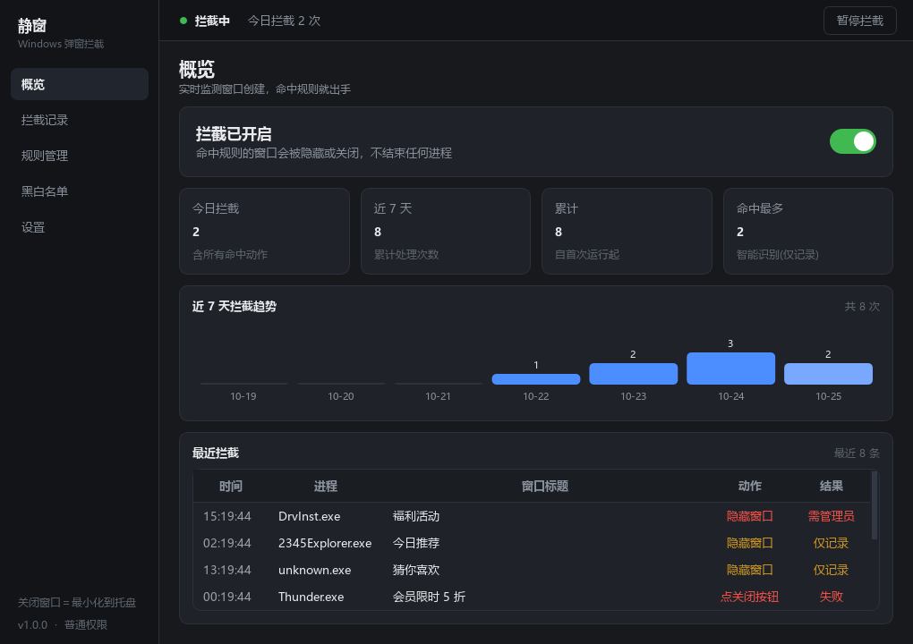
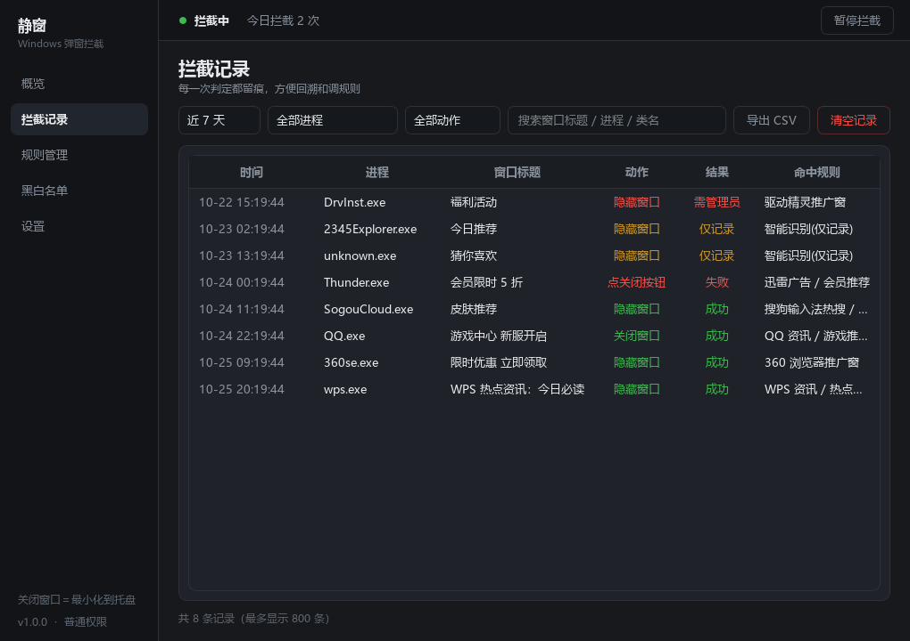
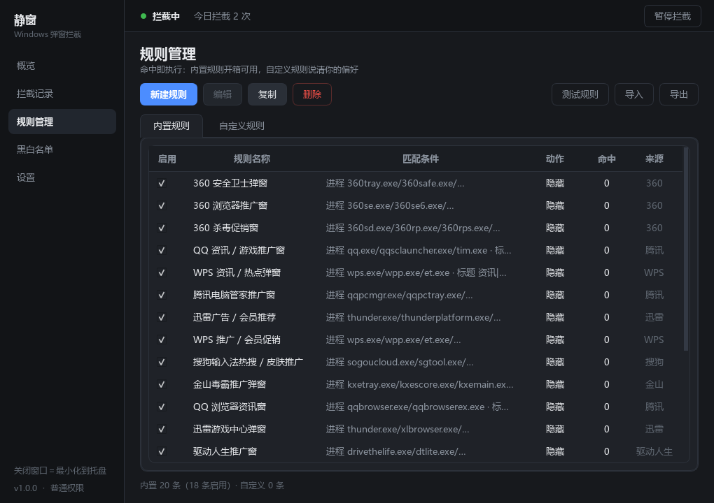

# 静窗 · SilenWindow

> Windows 桌面弹窗拦截器 —— 对标火绒「弹窗拦截」的核心功能
> **进程外窗口钩子 + 规则判定，不注入 DLL、不加内核驱动、不结束任何进程**



---

## 它能做什么

- **自动识别并拦截弹窗**：监听系统级的窗口创建/显示事件，命中规则就隐藏或关闭
- **开箱可用的规则库**：内置 WPS、360、腾讯、搜狗、迅雷、金山、驱动精灵、鲁大师、WinRAR 等常见推广弹窗特征，外加一组通用启发式规则
- **规则可管理可自定义**：图形化编辑器拼规则，支持导入导出 JSON、逐条启停、规则测试
- **黑白名单**：按进程名 / 路径 / 窗口类名 / 标题正则精确放行或拦截，配合"十字准星"点一下就抓取窗口特征
- **拦截记录与统计**：每次判定都留痕（时间、进程、窗口标题、动作、结果、命中规则），可按条件筛选、导出 CSV，另有 7 日趋势图
- **托盘常驻**：一键开启/暂停，关闭窗口不退出，支持开机自启
- **两种模式**：观察模式（只记录不拦截）用于先验证规则，确认无误后切实际拦截

## 界面

| 拦截记录 | 规则管理 |
|---|---|
|  |  |

---

## 工作原理

```
① SetWinEventHook(EVENT_OBJECT_CREATE / EVENT_OBJECT_SHOW,
                  WINEVENT_OUTOFCONTEXT | WINEVENT_SKIPOWNPROCESS)
   └─ 进程外全局钩子：系统把"某窗口被创建/显示"通知给我们，无需注入目标进程
                          ↓
② 钩子回调只做三件事：判 HWND 有效 → 判顶层可见 → 丢进队列（绝不干重活）
                          ↓
③ 工作线程：probe 反查类名 / 标题 / 样式 / 尺寸 / owner / 进程 / 是否前台
                          ↓
④ 判定：硬白名单 → 用户白名单 → 用户黑名单 → 规则库 → 启发式打分
                          ↓
⑤ 执行：SW_HIDE 隐藏 / PostMessage(WM_CLOSE) 关闭 / 模拟点关闭按钮
         （60 秒冷却 + 隐藏看门狗，防"关了又弹"死循环）
                          ↓
⑥ 落库 SQLite + 刷新界面与托盘计数
```

**为什么用进程外钩子**：不需要向目标进程注入 DLL，因此不会被杀软判定为注入行为、不会拖慢目标程序；最坏结果是漏掉一次事件，而不是把别人的程序搞崩。

判"是不是弹窗"最有效的一条经验：**看任务栏有没有按钮**。正常应用的主窗口一定有，广告弹窗基本都隐藏了。这一条比类名匹配可靠得多。

---

## 快速开始

### 方式一：直接用（不需要装 Python）

去 [Releases](../../releases/latest) 下载 `静窗.exe`，双击运行。绿色免安装，数据存在 exe 同级的 `data\` 目录。

> 没有代码签名，杀软可能提示风险。把程序所在文件夹加入信任即可。

### 方式二：从源码跑

需要 Python 3.10+（开发时用的 3.13）。

在上面的仓库页点 **`Code ▾` → `Download ZIP`** 解压，或者用 `git clone` 把本仓库拷到本地，然后：

```bat
cd PopupBlocker
python -m venv .venv
.venv\Scripts\python.exe -m pip install -r requirements.txt
启动.bat
```

或者手动：`.venv\Scripts\python.exe app\main.py`

**第一次使用**：默认是观察模式（只记录不拦截）。先让它跑一会儿，翻一翻「拦截记录」，确认没有误伤之后，再去概览页把总开关打开。

详细用法见 [使用说明.md](使用说明.md)，想改代码见 [开发说明.md](开发说明.md)。

---

## 项目结构

```
app/
├─ main.py              入口：单实例锁 → 建引擎 → 起托盘 → Qt 事件循环
├─ config.py            路径、版本、设置读写
├─ core/                钩子与引擎
│  ├─ hook_engine.py    Win32 全局窗口钩子 + 消息泵 + 补扫线程
│  ├─ window_probe.py   HWND → 特征包
│  ├─ classifier.py     判定引擎（优先级链 + 启发式打分）
│  ├─ action.py         执行器（隐藏/关闭/点击，冷却，权限检测）
│  ├─ rule_store.py     规则加载、匹配、导入导出
│  ├─ lists.py          黑白名单
│  ├─ stats.py          SQLite 记录与统计
│  ├─ process_info.py   PID → 进程信息
│  ├─ keyhook.py        拾窗期间的全局 Esc 兜底
│  └─ autostart.py      开机自启
├─ ui/                  PySide6 界面
│  ├─ main_window.py    侧边导航 + 状态条 + 页面容器
│  ├─ pages/            概览 / 拦截记录 / 规则管理 / 黑白名单 / 设置
│  ├─ dialogs/          规则编辑器 / 十字准星拾窗器
│  ├─ tray.py           托盘图标三态 + 菜单
│  ├─ widgets.py        主题 QSS + 自绘控件
│  └─ icons.py          代码画图标（无外部图片依赖）
└─ data/builtin_rules.json   内置规则库

tools/
├─ probe_test.py        命令行诊断：不开界面打印窗口事件流
├─ popup_simulator.py   造测试弹窗（5 种）
├─ live_test.py         端到端验证：造弹窗 → 检查是否被拦
├─ ui_snapshot.py       离屏渲染五页截图，检查排版
└─ rules_smoke.py       规则链路冒烟测试
```

---

## 技术栈

Python 3.13 · PySide6（Qt6）· pywin32 + ctypes（Win32 API）· psutil · SQLite · PyInstaller

---

## 已知限制（提前说明，避免失望）

1. **不是所有"弹窗"都是窗口**：网页内浮层、游戏内弹层、软件界面里自己画的广告，在 Win32 层面不是一个独立窗口，拦不了。
2. **管理员权限程序的窗口拦不住**：普通权限进程受 UIPI 限制，无法向高完整性级别窗口发消息。程序会提示"需管理员"。
3. **系统通知（右下角 Toast）不在范围内**：那不是窗口，需要另一套机制。
4. **可能误拦**：所以默认是观察模式，先看清单再决定；白名单是安全阀。
5. **和火绒的差距**：火绒有内核驱动和长期积累的特征库；本项目靠进程外钩子 + 规则，覆盖面弱一些。换来的是兼容性好、不和已装杀软打架。

---

## 开发与测试

```bat
:: 只看窗口事件流，不拦截
.venv\Scripts\python.exe tools\probe_test.py 10

:: 手动造弹窗（需要先开着静窗）
.venv\Scripts\python.exe tools\popup_simulator.py

:: 自动端到端验证（需要处于"实际拦截"模式）
.venv\Scripts\python.exe tools\live_test.py

:: 规则链路冒烟测试
.venv\Scripts\python.exe tools\rules_smoke.py

:: 打包
.venv\Scripts\python.exe build.py              # 目录版，推荐
.venv\Scripts\python.exe build.py --onefile    # 单文件版
```

---

## License

[MIT](LICENSE) © 2026 Wayne
